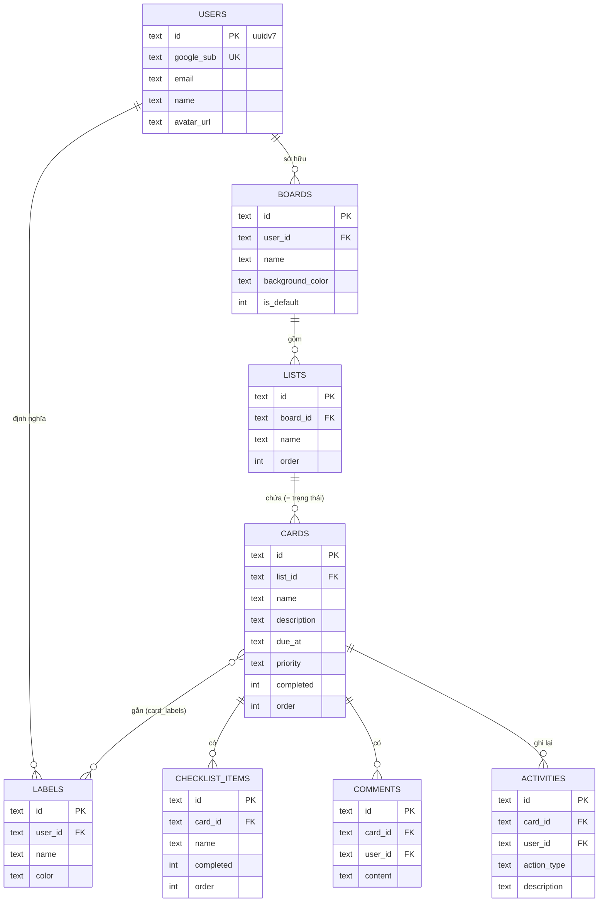

# Data Model: 001-personal-task-management

SQLite (libsql), quản lý bằng Drizzle. Thời gian lưu dạng ISO 8601 UTC (text); hiển thị theo giờ trình duyệt. Mọi bảng có `created_at`, `updated_at`.

## ERD (minh chứng DL-002)



Phần cốt lõi cho đề bài chỉ gồm **USERS – BOARDS – LISTS – CARDS**. Các bảng còn lại thuộc nhóm B (P3).

## Entities

### users
| Field | Type | Rules |
|---|---|---|
| id | text PK | UUIDv7 do server tạo |
| google_sub | text, unique, not null | `sub` trong Google ID token; với `/auth/dev` là `dev|<slug>` |
| email | text, not null | từ Google, đã xác minh |
| name | text, not null | tên hiển thị; fallback là phần trước `@` của email |
| avatar_url | text, null | |

Lần đăng nhập đầu tạo user + board mặc định (`is_default = 1`, tên "Việc của tôi") với ba list `Todo` (order 0), `Doing` (1), `Done` (2).

### boards
| Field | Type | Rules |
|---|---|---|
| id | text PK | UUIDv7; client có thể gửi |
| user_id | text FK → users.id, not null, on delete cascade | chủ sở hữu, dùng để tách dữ liệu |
| name | text, not null | 1–100 ký tự sau khi cắt khoảng trắng |
| background_color | text, null | `#RRGGBB` |
| background_url | text, null | chỉ dùng khi nhóm C được bật |
| is_default | int (0/1) | đúng một board mặc định mỗi user; không xoá được board mặc định |

### lists
| Field | Type | Rules |
|---|---|---|
| id | text PK | |
| board_id | text FK → boards.id, cascade | |
| name | text, not null | 1–100 ký tự |
| order | int, not null | ≥ 0 |

Trạng thái suy ra: `statusFromList(name)` → `todo` (mặc định) / `doing` (`doing`, `đang làm`, `in progress`) / `done` (`done`, `xong`, `đã xong`, `hoàn thành`).

### cards (task)
| Field | Type | Rules |
|---|---|---|
| id | text PK | |
| list_id | text FK → lists.id, cascade | list phải thuộc cùng board với đường dẫn request |
| name | text, not null | **1–200 ký tự** sau khi cắt khoảng trắng (FR-005) |
| description | text, null | ≤ 2000 ký tự |
| due_at | text (ISO), null | hợp lệ; không ở quá khứ khi tạo hoặc khi đổi (FR-007). Trường `deadline` trong API là bí danh của `due_at` |
| start_date | text (ISO), null | ≤ `due_at` nếu cả hai có |
| priority | text, not null, default `medium` | ∈ `high` / `medium` / `low` |
| completed | int (0/1) | tự đặt = 1 khi chuyển vào list Done, = 0 khi rời Done |
| due_complete | int (0/1) | giữ tương thích giao diện; luôn bằng `completed` |
| order | int, not null | vị trí trong list |
| cover_color | text, null | `#RRGGBB` |
| reminder_minutes, repeat_frequency, repeat_interval, recurrence… | null | lưu nguyên giá trị để giao diện không lỗi; không có hành vi phía server (nhắc hạn và lặp lại nằm ngoài phạm vi) |

### labels, card_labels
- `labels(id, user_id FK, name ≤ 50, color #RRGGBB)`: nhãn theo người dùng.
- `card_labels(card_id FK, label_id FK, PK(card_id, label_id))`: label phải cùng chủ với card.

### checklist_items
`(id, card_id FK, name 1–200, completed 0/1, order)`.

### comments
`(id, card_id FK, user_id FK, content 1–5000)`. Chỉ tác giả sửa hoặc xoá được.

### activities
`(id, card_id FK, user_id FK, action_type, description, metadata json null)`. Server tự ghi khi tạo card, đổi list, đổi tên, đổi hạn.

## State transitions (task)

```text
          tạo (mặc định)
              │
              ▼
   ┌────── Todo ◀──────┐
   │          │        │
   │  chọn Doing       │ chọn Todo
   │          ▼        │
   │        Doing ─────┤
   │          │        │
   │  chọn Done        │
   ▼          ▼        │
  Done ◀──────┘ ───────┘   (có thể chuyển thẳng giữa bất kỳ hai trạng thái nào)
```

- Vào **Done**: `completed = 1`, `due_complete = 1`; task không còn tính "quá hạn".
- Rời **Done**: `completed = 0`, `due_complete = 0`.
- **Quá hạn** là trạng thái suy ra, không lưu: `status ≠ done AND due_at < now`.
- **Xoá** là xoá cứng, cascade checklist, comments, card_labels, activities. "Hoàn tác" ở giao diện tạo lại task với dữ liệu cũ (ID mới).

## Truy vấn quan trọng
- **Tất cả task của tôi**: cards ⨝ lists ⨝ boards WHERE boards.user_id = :me, kèm `listName`, `boardId`, `boardName`, labels.
- **Kiểm tra quyền**: mọi truy vấn theo `:boardId` đều kèm `boards.user_id = :me`; không thoả → 404.
- **Chỉ mục**: `boards(user_id)`, `lists(board_id)`, `cards(list_id)`, `cards(due_at)`, `users(google_sub)` unique.
